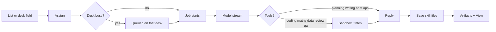
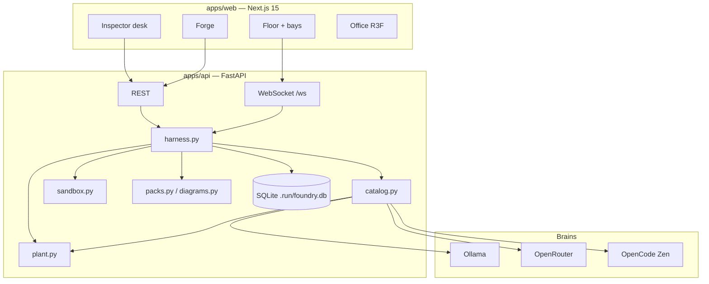

# Agent Factory

**A personal AI factory.** You forge named agents, give them a desk, and assign real work. Lists sit on the left. Agents occupy the floor. The selected desk shows history, files, and a live answer — not a chatbot inbox.

This is the workspace at [`YoussiefKhalifa2003/AgentFactory`](https://github.com/YoussiefKhalifa2003/AgentFactory). It is built for one operator first: you. The UI is paper-light on purpose. Clicking an agent opens their **desk**, not 3D. **Office** is the whole room — opt-in from the header or the banner on the floor.

<p align="center">
  
  
  
  
</p>

```text
  lists ──► desks ──► job ──► files on the desk
                │
                └── View: page · chart · sheet · PDF
```

---

## Contents

- [What you get](#what-you-get)
- [Tour](#tour)
- [Strengths](#strengths)
- [Tool skills](#tool-skills)
- [How a job runs](#how-a-job-runs)
- [Models](#models)
- [Architecture](#architecture)
- [Adding a skill](#adding-a-skill)
- [Run it](#run-it)
- [Phone](#phone)
- [Environment](#environment)
- [API](#api)
- [Evals](#evals)
- [Security](#security)
- [Repo layout](#repo-layout)
- [Stack](#stack)

---

## What you get

| Surface | What it is |
| --- | --- |
| **Workspace** | Lists on the left, agent bays in the middle, the selected desk on the right |
| **Forge** | Create an agent: look, one or two strengths, optional tool skills, a brain |
| **Desk** | Assign work, read the finished answer, **View** / **Download** files |
| **Office** | Optional 3D room of *every* desk — never opened by clicking a bay. A live diorama sits on the Floor; click it to walk in.
| **Jobs** | Stored work with status, tokens, artifacts — not a throwaway chat log |

The header lists every busy name (`Ada and Euclid are working`). Four labelled plant rows (This PC, Spark 1, Spark 2, Cloud) sit in the Plant chip. `Ctrl+K` opens the command palette. Insights and Results are in the header, not buried.

A list can send work down a **crew** (Scout then Cade then Hamza) or **Let the floor split it**. Drop on a bay is still one desk. Finished View files land on a **showroom** under the bays and in **Results**. **Start night shift** in Plant runs parked items up to eight, then the morning note lists finishes, blocks, and pins.

---

## Tour

### Lists

Inbox in, Done out. Custom lists sit under those. Meeting actions can be pulled in if the Meeting Note Taker database is on this machine. Drag a task onto a bay, or click assign. Suggested strength is inferred from the text (code, maths, research, writing, data, planning, ops, review, brief, qa). Finished jobs land in **Done** — click a card to open View.

### Floor

Each bay is a desk. Selected = outline. Working = live pigment. Drop a task on the person who should own it.

### Desk card

- Strengths: max **two** (the kind of work)
- Tools: extras that stack (draw.io, spreadsheet, PDF, slides)
- Model picker: local Ollama, OpenRouter, or OpenCode Zen
- Thread: the live job (and at most one last answer). Finished work is in **Done** on the left. **View** for the best file
- Hand a one-off task from the field at the bottom

**View** is not a dump of attachments. It picks the strongest file first:

1. Website (`index.html`)
2. Mermaid chart
3. Spreadsheet
4. PDF
5. draw.io
6. Image

Other files stay as extra View buttons and short Download labels (`Download sheet`, `Download PDF`, `Download chart`).

### Office

A banner on the floor — a live miniature of the room — and an **Office** segment in the header. One room, every agent as a unique clay figure, live screens, skill-dressed desks, Spark racks and the 4090 as plant equipment, finished work on the showroom wall. Night shift dims the lights. A crew job flies a folder between desks. Click a person to open their desk. Clicking a bay never jumps you into 3D.

The Desk inspector is tabbed: **Work** (live trace + result hero), **Files**, **Record**, **Setup**.

---

## Strengths

Strengths decide **what kind of job** the desk is for. Clamp is two. They map 1:1 to `skills/<id>/SKILL.md`.

| ID | Label | The desk does |
| --- | --- | --- |
| `coding` | Coding | Writes files, runs Python, builds a small page |
| `maths` | Maths | Checks answers in code |
| `research` | Research | Fetches pages you pointed at, cites them |
| `writing` | Writing | Drafts, emails, one-pagers in the reply |
| `data` | Data | Tables, metrics, analysis |
| `planning` | Planning | Ordered plans. No LLM tools (local Qwen mishandles tool JSON) |
| `ops` | Ops | Follow-ups, owners, process |
| `review` | Review | Verdict + numbered findings. Saves `review.md`. Searches a linked repo |
| `brief` | Brief | Situation / So-what / Ask / Next. Reply only |
| `qa` | QA | Writes `test_*.py` and runs them |

The **first** strength on the bay is the job type. The harness pins that pack as PRIMARY and uses a protocol for that skill (coding writes files, review writes findings, brief stays in the reply). A second strength is an extra, not a reason to wander.

Built-in harness tools (not skills): `write_file`, `read_file`, `run_python`, `list_workspace`, `fetch_url`. Coding, maths, data, review, QA, and slides get those tools. Research gets `fetch_url` when the prompt contains a URL. Planning, writing, brief, and ops stay in the reply.

Starter bays if the database is empty:

| Agent | Strength |
| --- | --- |
| **Ada** | Coding |
| **Euclid** | Maths |
| **Scout** | Research |

---

## Tool skills

Tool skills are **addable packs**. They do not count against the two-strength cap. Toggle them on the desk or on the Forge **Tools** step.

| ID | Label | Deliverable | View |
| --- | --- | --- | --- |
| `drawio` | draw.io | `diagram.mmd` + `diagram.drawio` | Mermaid chart (draw.io is the extra) |
| `spreadsheet` | Spreadsheet | `sheet.csv` | Table on the desk |
| `pdf` | PDF | `pack.pdf` | Inline PDF — the file you send |
| `slides` | Slides | `slides.html` | Deck — one paper-light template, open with View |

A writing desk drafts in the thread. A writing desk **with PDF** produces a pack you can email. A data desk analyses. A desk **with Spreadsheet** leaves a sheet you can open.

Discovery: any `skills/<name>/SKILL.md` with YAML `kind: tool` appears in the Tools list automatically.

## Linked repositories

A list, including a meeting list, can be linked to a Tatweer Azure DevOps project. Put `AZURE_DEVOPS_PAT` in `apps/api/.env` (code read). You can add the token and press **Sync** without restarting the API. Projects stay on a shelf so you do not paste the same git URL every time: pick Stormcast, or paste a new repo link. **Refresh** / **Sync** pulls the local cache. Extra repos on the same project live beside the default checkout. The list still links if the token is not set yet; desks cannot read the repo until Sync succeeds.

Every desk that receives a task from that list can search and read those files. Planning and writing desks get that access too. They still do not get the sandbox write tools.

Finished work on that project is remembered on a shared ledger. The next desk on the same project sees who did the earlier job, what they wrote, and a short line for whoever is on the floor now. A different project does not. The token is never stored in the database or the prompt.

The header power strip shows four dots: This PC (the 4090), Spark 1, Spark 2, and Cloud. Spark 2 stays dark if its engineer key is rejected.

---

## How a job runs



1. Assign creates a job in SQLite (`.run/foundry.db`) and a per-job workspace under `.run/workspaces/<agent>/<job>/`.
2. Tokens stream over WebSocket (`job.token`, `job.activity`, `job.done`).
3. The harness may call tools, then salvage fences (HTML, mermaid, CSV, markdown) so a claimed file actually exists.
4. Artifacts are collected at finish. **View** reads them from the API.

Several desks can work at once. **Local Ollama is one generation at a time** so two huge models do not fight a 24GB GPU. **Spark 1 also runs one factory job at a time** — a second stream used to sit in Spark’s queue until Cade finished, which made Yousef look stuck. The second Spark desk now starts immediately on Spark 2 (if that key works) or on OpenRouter / Zen instead of waiting. A second local job shows **Waiting for the local GPU…**; a second Spark job shows **Spark is busy — switching**. If the API reloads while desks are working, those jobs pick back up on the same desks instead of showing **Stopped**. Stop is only when you halt a job from the desk.

---

## Models

Each agent has one brain. Switch it on the desk.

| Provider | Examples | Notes |
| --- | --- | --- |
| **This machine** (Ollama) | Qwen3 14B (~10 GB), Qwen3.6 35B (~22 GB), Qwen3 VL 8B (~6 GB) | Serialized. Default `http://127.0.0.1:11434` |
| **Spark** (office DGX) | Qwen3.6 35B, Qwen3.8 27B, Qwen3 VL 32B / 8B | LiteLLM on the office LAN. Needs `SPARK_API_KEY`. Not the 4090. |
| **OpenRouter** | DeepSeek V3, Gemini 2.5 Flash, GPT-4o mini | Needs `OPENROUTER_API_KEY` |
| **OpenCode Zen** | `big-pickle`, `mimo-v2.5-free`, `ling-3.0-flash-fin-free` | Free tier. Do not spoof the OpenCode User-Agent |

A useful mix on a 4090: Ada on local 35B **and** Euclid on Gemini at the same time. Two 35B loads will not fit; the lock exists so they take turns instead of crashing.

Spark is the DGX on the office LAN (`192.168.100.129:4000`), not OpenCode’s `muse-spark` model names. Ollama on Spark is not reachable from this PC — jobs go through the LiteLLM gateway. Spark 2 is `192.168.100.127:4000` and needs its own engineer key (`SPARK2_API_KEY`); Spark 1’s key is rejected there. Office network only. Use your engineer key, not the shared admin master key.

---

## Architecture



| Path | Role |
| --- | --- |
| `apps/web` | Workspace UI, Forge, 3D stage, mermaid viewer |
| `apps/api` | Jobs, agents, lists, artifacts, GPU lock |
| `skills/` | Strength packs + tool packs (`SKILL.md`) |
| `.run/` | Database, workspaces, portraits — gitignored |
| `evals/` | Coding + maths smoke jobs |

The API does not pretend to be OpenCode. Keys live only in `apps/api/.env` (gitignored). Copy `apps/api/.env.example`.

---

## Adding a skill

Tool skills are folders, not hardcoded UI.

```text
skills/my-tool/SKILL.md
```

```markdown
---
name: my-tool
label: My tool
kind: tool
description: One line for the Forge card.
---

# My tool

When to use it. What file lands on the desk. How View should feel.
```

- `kind: tool` → Tools row (does not eat a strength slot)
- omit it, and keep the id in `apps/api/strengths.py` → a strength
- Restart is not required for discovery on the next `/api/strengths` fetch if the API reloaded; the UI reads that catalog

Wire any new file type in `harness.py` (save) and `Inspector.tsx` (View) the same way CSV and PDF were added.

---

## Run it

**Need:** Node 20+, Python 3.12+, optionally [Ollama](https://ollama.com) with the tags you pin.

### 1. Secrets

```powershell
copy apps\api\.env.example apps\api\.env
```

Fill what you use. Never commit `.env`.

### 2. API

```powershell
cd apps/api
python -m venv .venv
.\.venv\Scripts\pip install -r requirements.txt
.\.venv\Scripts\python -m uvicorn main:app --reload --reload-exclude "$PWD\.venv" --host 127.0.0.1 --port 8000
```

### 3. UI (second terminal)

```powershell
cd apps/web
npm install
npm run dev
```

Open [http://localhost:3000](http://localhost:3000). API is [http://127.0.0.1:8000](http://127.0.0.1:8000).

### One-shot (Windows)

From the repo root:

```powershell
.\scripts\dev.ps1
```

Two PowerShell windows: API on **8000**, UI on **3000**.

---

## Phone

iPhone client is a PWA in `AI_HarnessPhone`, reached over Tailscale. Models stay on the PC. Walkthrough: [`AI_HarnessPhone/README.md`](AI_HarnessPhone/README.md). Build and print the Serve command:

```powershell
.\scripts\phone.ps1
```

Then `tailscale serve --bg 8000` and Safari → Add to Home Screen. Do not expose port 8000 on the LAN.

---

## Environment

| Variable | Purpose |
| --- | --- |
| `OPENCODE_API_KEY` | OpenCode Zen |
| `OPENCODE_BASE_URL` | Default `https://opencode.ai/zen/v1` |
| `OPENROUTER_API_KEY` | OpenRouter |
| `OPENROUTER_BASE_URL` | Default `https://openrouter.ai/api/v1` |
| `OLLAMA_BASE_URL` | Default `http://127.0.0.1:11434` |
| `SPARK_BASE_URL` | Default `http://192.168.100.129:4000/v1` (Spark 1 LiteLLM) |
| `SPARK_API_KEY` | Engineer key for Spark 1 |
| `SPARK2_BASE_URL` | Default `http://192.168.100.127:4000/v1` (Spark 2 LiteLLM) |
| `SPARK2_API_KEY` | Engineer key for Spark 2 (Spark 1’s key does not work here) |
| `MEETING_NOTES_DB_PATH` | Optional Meeting Note Taker SQLite |
| `MEETING_ME_ALIASES` | Names treated as “mine” on meeting actions |
| `AZURE_DEVOPS_PAT` | Read code from a linked Azure DevOps repository |
| `HOST` / `PORT` | API bind (default `127.0.0.1:8000`) |
| `FOUNDRY_TOKEN` | Optional. If set, HTTP `Authorization: Bearer` and WebSocket `?token=` are required |

Frontend (optional, `apps/web/.env.local`):

| Variable | Default |
| --- | --- |
| `NEXT_PUBLIC_API_URL` | `http://127.0.0.1:8000` |
| `NEXT_PUBLIC_WS_URL` | `ws://127.0.0.1:8000/ws` |

---

## API

| Method | Path | |
| --- | --- | --- |
| `GET` | `/api/health` | Zen / OpenRouter / Ollama flags + plant. `?ping=1` is a fast `{ok: true}` |
| `GET` | `/api/models` | Catalog + availability |
| `GET` | `/api/strengths` | Strengths + tool skills |
| `GET`/`POST` | `/api/agents` | Roster / forge |
| `PATCH`/`DELETE` | `/api/agents/{id}` | Desk settings / remove |
| `POST` | `/api/agents/{id}/pfp` | Portrait upload |
| `GET`/`POST` | `/api/lists` | Stored to-do lists |
| `PATCH` | `/api/lists/{id}` | Link or unlink a project |
| `GET`/`POST` | `/api/projects` | Azure DevOps project shelf |
| `POST` | `/api/projects/{id}/sync` | Refresh the local code cache |
| `POST` | `/api/projects/{id}/repos` | Add another repo on that project |
| `GET` | `/api/projects/{id}/memory` | Shared ledger for that project |
| `GET` | `/api/plant` | This PC / Spark / Cloud occupancy |
| `POST` | `/api/assign` | Hand a list item or text to a desk. Optional `chain` or `foreman` |
| `GET` | `/api/chains/{id}` | Handoff steps |
| `GET` | `/api/showroom` | Floor pins |
| `POST`/`DELETE` | `/api/pins` | Pin or unpin a View file |
| `POST` | `/api/shift/start` | Night shift, cap 8 |
| `POST` | `/api/shift/stop` | Stop and write the morning note |
| `GET` | `/api/shift/latest` | Latest note |
| `GET` | `/api/meetings` | Optional Meeting Note Taker feed |
| `POST` | `/api/jobs` | Direct job |
| `POST` | `/api/jobs/{id}/cancel` | Stop a running job |
| `GET` | `/api/jobs/{id}/trace` | Tool timeline for the Work tab |
| `GET` | `/api/jobs/{id}/site/{path}` | Inline website |
| `GET` | `/api/stats` | Desk stats for Insights |
| `GET` | `/api/artifacts/{id}/file` | Inline; `?download=1` to save |
| `WS` | `/ws` | `job.token`, `job.activity`, `job.trace`, `job.done`, `job.artifact`, `job.file`, `plant`, `chain.updated`, `shift.updated` |

Sandbox: timed Python, no network, path confined to that job’s folder.

---

## Evals

With the API up, from repo root:

```powershell
python evals/run.py
```

Prompts live in `evals/coding.md` and `evals/maths.md`. Ada and Euclid must exist (they are seeded on first boot).

---

## Security

- Keys only in gitignored `.env`
- Workspaces are per job, not shared across agents
- `run_python` is isolated and timed; it cannot see the host tree
- `fetch_url` is for pages the user asked to open
- Mermaid render uses `securityLevel: "strict"`
- This is a **personal** factory on localhost. Do not expose `8000` on the LAN. Tailscale Serve proxies HTTPS to loopback. Set `FOUNDRY_TOKEN` if anything besides your desktop tab will call the API

---

## Repo layout

```text
AgentFactory/
├── apps/
│   ├── api/                 FastAPI harness
│   │   ├── main.py          HTTP + WebSocket
│   │   ├── harness.py       Jobs, tools, salvage
│   │   ├── catalog.py       Models + GPU lock
│   │   ├── sandbox.py       Workspace + Python
│   │   ├── diagrams.py      Mermaid → draw.io
│   │   ├── packs.py         CSV detect + PDF
│   │   └── strengths.py     Strength + tool catalog
│   └── web/                 Next.js workspace
│       ├── app/             Routes
│       └── components/      Floor, Inspector, Forge, Stage
├── AI_HarnessPhone/         iPhone PWA (static export, port 3001 in dev)
├── packages/ui-tokens/      Shared paper/ink/pigment CSS
├── skills/                  SKILL.md packs
├── avatar/                  3D kit notes
├── evals/
├── scripts/dev.ps1
├── scripts/phone.ps1
└── README.md
```

---

## Stack

| Layer | Choice |
| --- | --- |
| UI | Next.js 15.5, React 19, Tailwind v4, Newsreader + Geist |
| 3D | React Three Fiber, drei, three, postprocessing |
| Charts | mermaid |
| Motion | motion, cmdk, sonner |
| API | FastAPI, SQLite, WebSocket |
| PDF | fpdf2 |
| Local models | Ollama (this machine) |
| Office GPU | DGX Spark via LiteLLM |
| Cloud | OpenRouter, OpenCode Zen |

---

## Status

Jobs fail closed when a test, a source, or a linked stylesheet or script is missing or cut off. View does not replace that script with a different game. A blocked desk keeps the answer it already wrote and shows the real reason. Stop ends a running job. A refresh keeps the live answer. The chosen model is tried first, then another configured provider.

Personal-first. Every change from here is committed and pushed to this repository. Forge someone, put a list on their desk, hit View.
