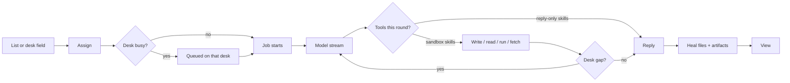
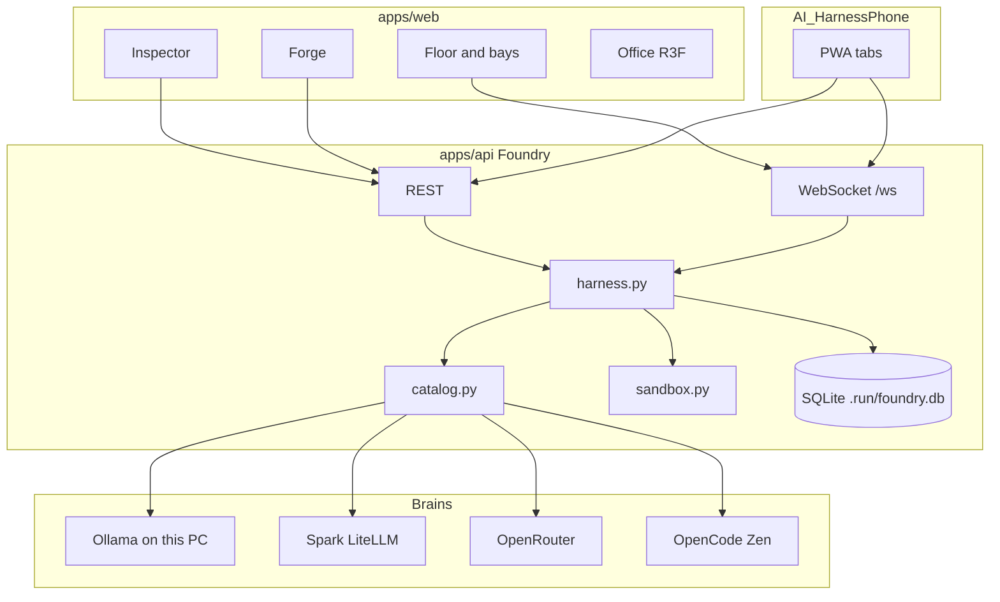

# Agent Factory — what this is, and how we built it

This is the story of the system. [README.md](../README.md) is the operator runbook: how to start it, which env vars exist, which HTTP routes exist. This page is what you would tell a friend, and then what you would tell an engineer sitting next to you.

The public GitHub name is **Agent Factory**. The window title is **Workspace**. The API process still calls itself Foundry — that is an internal name, not something the UI says out loud.

---

## 1. What this is

You do not open a chatbot and hope the last message is the product. You forge **named agents**, sit them at **desks**, and hand them **real work** from a list. When they finish, files land on that desk. You press **View** and you get a page, a chart, a sheet, a PDF, or a game — not a transcript.

It is a **personal AI factory**. One operator first: you. Lists on the left, people on the floor, the selected desk on the right. The room is paper-light on purpose. Clicking a person opens their desk. The 3D office is opt-in. The phone is the same factory in your pocket.

Under the floor: a FastAPI control plane, a SQLite ledger, a sandbox per job, and a catalog of brains (this PC, two office Sparks, OpenRouter, OpenCode Zen). Models write files. The harness checks that the files they claimed actually exist, then serves them.

---

## 2. The floor, in human terms

### What you see

Three panes:

- **Lists** — Inbox in, Done out. Custom lists under those. Meeting actions can appear if the Meeting Note Taker database is on this machine. A list can be linked to an Azure DevOps repo so desks can search that code.
- **Floor** — Each **bay** is a person and a desk. Selected = outline. Working = live pigment. Drop a to-do on the person who should own it.
- **Desk** — Not a chat inbox. The live job, at most one last answer, **View** / **Download**, and a hand field at the bottom. Tabs: Work, Files, Record, Setup.

**Forge** is how a new agent is born: look (clay figure: body, hair, pigment), one or two **strengths** (the kind of job), optional **tool skills** (draw.io, spreadsheet, PDF, slides), and a **brain** (which model).

**Office** is the whole room in 3D. You walk in from the header or the miniature banner on the floor. Clicking a bay never dumps you into 3D. A **Desk** button may open a close-up of that station.

**Phone** (`AI_HarnessPhone`) is a PWA: Lists / Floor / Desk, hold-to-talk, View. No 3D. No Forge. No Agent Brain specimen. Models stay on the PC.

**Agent Brain** is plant-wide Azure knowledge, not a model and not Insights. Header **Brain** (or the command palette) opens a clay specimen overlay: paste an org link and it clones every project and every repo, then catalogs every text file. Lists can still pin one repo. Inbox jobs with no list pin inherit Brain. Bay click never opens Brain or Office.

If the roster is empty, three starters are seeded: **Ada** (coding), **Euclid** (maths), **Scout** (research). Other names (Cade, Hamza) are people you forge, not defaults.

### How it is built

The desktop UI is Next.js 15 + React 19 in `apps/web`. The shell is `FactoryApp`. The inspector is `Inspector.tsx`. The floor is bays; the optional stage is React Three Fiber (`OfficeCanvas`, `SceneRoot`). Tokens (paper, ink, pigment) live in `packages/ui-tokens` and are shared with the phone.

State streams over `ws://127.0.0.1:8000/ws`. Hello snapshot (including Agent Brain), then `job.*`, `plant`, `brain.updated`, `chain.updated`, `shift.updated`. The API is FastAPI in `apps/api`. SQLite is `.run/foundry.db` (gitignored). Per-job folders are `.run/workspaces/<agent-id>/<job-id>/`. Azure checkouts live under `.run/repos/`.

Domain strengths are capped at **two**. The first strength is the job type. Tool skills do not count against the cap. That clamp is product, not a model limitation.

---

## 3. A job, as you experience it

You type a task, drag an Inbox row onto a bay, or tap Assign. That desk lights up. Tokens stream. A Work tab shows tools as they fire. On coding, maths, or QA, a **critic** on another idle desk may write `critic.md`. If they fail the product, the producer is asked to fix it.

When it is done, **View** opens the strongest file:

1. Website (`index.html`)
2. Mermaid chart
3. Spreadsheet
4. PDF
5. draw.io
6. Image

Other files stay as extra buttons. Finished View files also land in **Results** and on the Office **showroom** wall.

You can send work as:

- **One desk** — drop on a bay.
- **Crew** — tap desks in order (Scout then Cade then Hamza). A folder flies between them in Office.
- **Split** — “Let the floor split it” breaks a numbered list onto matching strengths.

**Night shift** in Plant launches parked items up to eight, then writes a morning note: finishes, blocks, pins, who was coached.

**Stop** on a running job is supposed to mean the GPU actually stops — not just the UI spinning down.

---

## 4. A job, as the machine does it

1. `lists.assign` creates a SQLite job and, if the desk is free, claims it. If the desk is already thinking, the item waits.
2. `harness.run_job` sets status **thinking**, broadcasts `job.started`, and builds a system prompt: role + **PRIMARY** skill pack + protocol (coding writes files, review writes findings, brief stays in the reply).
3. Fast paths skip the LLM: greetings, pasted user code, some maths.
4. Otherwise up to **ten** tool rounds. Native `tool_calls` run in the sandbox. If the model dumps fences or XML tools instead, those are applied too.
5. After tools, `_desk_gap` asks `site_gap` / `game_gap`. Missing `js/main.js` or a cut-off stylesheet is a reason to go again, not a reason to mark done.
6. From round **six**, salvage is on: `heal_site`, `ensure_game_tree`, `finish_site` run before the gap check.
7. `_finish` materializes the site, heals, collects artifacts, `_verify`s. Pass → **done**. Fail → **blocked** with the real reason. Empty junk tries a recap, then salvage, then block.
8. **cancelled** is only Stop. Reloading the API resumes in-flight jobs; it does not pretend they were stopped.

Statuses in flight: `queued`, `thinking`, `tool`. Terminal: `done`, `blocked`, `cancelled`.

Workspaces cannot escape their job folder. `run_python` is `python -I`, 25s, no network, stripped env. Text writes cap around 400KB; reads cap at 80KB.

Live UI is not polling the answer. It is WebSocket events: `job.token`, `job.activity`, `job.trace`, `job.file`, `job.artifact`, `job.done`.

---

## 5. Who gets tools

A desk is not “an LLM with every function.” Tools are gated on purpose. Local Qwen mishandles tool JSON on planning jobs; those desks stay in the reply.

| Kind of desk | What the model may call |
| --- | --- |
| Coding, maths, data, review, QA, slides, critic jobs | `write_file`, `write_bytes`, `read_file`, `run_python`, `list_workspace`, `fetch_url` |
| Research, only if the prompt has a URL | `fetch_url` |
| Planning, writing, brief, ops | Reply only (writing may fetch a pasted URL) |
| Any job on a **linked project** | `repo_search`, `repo_read`, `recall` even without sandbox write |
| Coding / QA / review / maths, or a desk that already has HTML or `eyes/` images | `look_at`, `list_eyes`, `capture_view`, `click_view` |

After a successful tool round with no desk gap, tools are **turned off** and the model is asked for a finished reply. Empty `write_file` bodies are rejected as truncated.

Skill packs live in `skills/<id>/SKILL.md`. The harness pins the first strength as PRIMARY. A second strength is extra, not a license to wander. **Never rewrite** the git-tracked `skills/*/SKILL.md` from a job. Coach notes, if any, are overlays under `.run/skills/<agent>/`.

Tool skills (`drawio`, `spreadsheet`, `pdf`, `slides`) are addable packs. They do not eat a strength slot. A writing desk drafts in the thread; a writing desk **with PDF** leaves a pack you can email.

---

## 6. The critic

Serious work should not mark itself done. Coding, maths, and QA jobs get a **second idle desk** injected as the next chain step. That critic must call `list_files`, then write `critic.md` as Verdict plus Findings (`high`, `block`, or `low`). If the site is playable they may screenshot Start. They must not rewrite the product.

If findings are high or block, the producer is re-queued once (retry max 2) with “Fix the critic findings… match the original request.” Chain length is capped (critic injection 7; user crews normalize smaller). One person on the floor skips self-review rather than judging themselves.

Critic prompts for FPS / CSGO-like jobs fail high if the files shrank the request into a top-down square or dropped WASD, mouse look, click-to-shoot, a map, or a HUD.

---

## 7. Brains and the plant

Each agent has **one** model (“brain” on the desk). That is not **Agent Brain**. Agent Brain is the plant-wide Azure estate (org, every repo, wiki) that every unlinked desk can search. Models are not trained on it; they get the wiki, a catalog of every file, and `repo_search` / `repo_read` / `recall`. You switch the desk model in Setup.

| Where | What | Why it exists |
| --- | --- | --- |
| **This PC** (Ollama) | Qwen3 14B / 35B, VL 8B | Serialized. Two huge models must not fight 24GB VRAM. A second local job shows “Waiting for the local GPU…” |
| **Spark 1 / Spark 2** | Office DGX via LiteLLM | Not the 4090. One factory job per box. A second Spark job starts on Spark 2 (if that key works) or fails over to cloud instead of sitting in Spark’s queue |
| **OpenRouter** | DeepSeek, Gemini Flash, GPT-4o mini | When the office GPUs are busy or the job fits cloud |
| **OpenCode Zen** | Free-tier chat models | Default if nothing local is up. **Do not spoof** the OpenCode User-Agent |

Token ladders shrink `max_tokens` on context errors (Spark 131072 → 65536 → 32768; OpenRouter / Zen 65536 → 32768). Local Ollama uses a large `num_predict` / `num_ctx` instead of that ladder.

**Stop** must fully kill local GPU work: the job is marked aborted, in-flight HTTP is closed, and Ollama is posted `keep_alive: 0`. A cancelled generate must not keep spinning the 4090.

The header **Plant** chip is four rows: This PC, Spark 1, Spark 2, Cloud. Spark 2 stays dark if its engineer key is rejected. Occupancy is `plant.py` plus catalog locks.

**Coach** records which model actually shipped for a skill. After enough non-infra outcomes it can prefer a winner. Night shift may retry blocked jobs once and write a short overlay. **Forget coaching** in Plant wipes that. Git skill packs stay clean.

Vision: if you drop a screenshot into `eyes/`, the catalog may swap to a VL tag (`local:qwen3-vl:8b` or Spark VL). We do not steal a Spark desk’s GPU to run local VL in the background.

---

## 8. View, sites, and games

View is an iframe of a **real document**, not a zip of leftovers. HTML is served from `GET /api/jobs/{id}/site/{path}` with a `<base href>` so relative CSS and JS resolve. Games get a WebSocket shim: `window.FOUNDRY_GAME_WS` is a factory room for that job (`/api/games/{id}/ws`, max four browsers). The sandbox still has no network.

Models lie. They write `index.html` that links `styles.css` and never write the stylesheet. They dump three files labeled as a game. They put Three.js in `main.py`. They unclose a template literal and the whole script dies. They ship a 24×24 square and call it an FPS.

The harness treats that as **our** bug, not yours.

After the model (and during salvage):

1. **`materialize_site`** — unescape dumps, split labeled pastes, extract fences, do not inject `script.js` if the page already has inline JS.
2. **`heal_site`** — if `js/main.js` exists, make sure the page loads it as a module. Never replace the agent’s file with a different game.
3. **`ensure_game_tree`** — a game prompt needs `js/main.js`, `js/input.js`, `js/entities.js`, `js/net.js`, a level JSON, CSS, README, Start. FPS / “3D shooter” jobs that still look like a toy square get a playable first-person boot (WASD, mouse look, shoot, HUD) and a real overlay stylesheet, not a one-line stub.
4. **`finish_site`** — close truncated HTML/JS, plant missing CSS/JS/images/imports or strip dangling tags, drop duplicate `script.js` when the same code is already inline.

`playable_page` then strips any local `<script>` / `<link>` whose file is still missing, injects overlay CSS so Start is clickable, and sizes the canvas. Leftover 404s on JS/CSS/JSON/PNG return empty stand-ins instead of killing the page.

A job that asked for an advanced 3D shooter is not “done” because `index.html` exists. `wants_fps` includes CSGO-like wording **and** 3D + shooter. `fps_gap` looks at `js/main.js`, not a leftover `script.js` stub. Linked scripts must parse (`node --check`). View hides leftover loading overlays so a SyntaxError cannot freeze the iframe on “LOADING TRACK”.

---

## 9. Office (3D)

Office is a diorama of **every** desk, not a video-game prize for clicking a bay.

- Header **View → Office**, or the live miniature banner on the floor, walks you into the room. Agent Brain is a separate header overlay, not a fourth Floor/Office/Desk mode.
- **Desk** / **3D desk** orbits one station.
- Click a **person** in the room to select their inspector desk. Bay click still never opens 3D.
- Figures are unique clay looks from Forge. **Hamza**, by name, uses the Vexel-simplified OBJ (face, jeans, sneakers) rather than a blob.
- Skill-dressed desks, Spark racks and the 4090 as plant equipment, finished work pinned on the **showroom** wall.
- Night shift dims the lights. A crew job flies a folder between desks.
- Quality in Plant: high / medium / low / off (2D iso). It can drop to medium when the local GPU is busy.

The 3D stack is three, React Three Fiber, drei, postprocessing. WebGL fallback exists. `LiveStrip` in the codebase is not the floor; Plant is.

---

## 10. Phone

The iPhone client is a PWA in `AI_HarnessPhone`. Safari → Add to Home Screen. There is **no service worker** — a stale shell would lie about live jobs.

Models, SQLite, and workspaces stay on the Windows PC. The phone is a second client of the same API and the same `/ws` hub. Production path is Tailscale Serve to loopback `:8000`, not exposing 8000 on the LAN. If `FOUNDRY_TOKEN` is set, paste it once in the gear.

Desktop Workspace stays on **3000**. Phone dev is **3001**. Building the phone app never runs `npm run build` in `apps/web` while `next dev` is up.

---

## 11. How we built it (the decisions)

These are the constraints that shaped the factory, not a changelog.

**It is a factory, not a chat.** A job is stored work with status, tokens, and artifacts. The desk shows the live job and one last answer. History lives in Done.

**Paper-light, named people.** Cream, ink, Newsreader. Each agent has a pigment and a look. The title is Workspace. The GitHub name is Agent Factory.

**Two strengths, tools extra.** The first strength is the protocol. Tools (PDF, sheet, slides, draw.io) stack without stealing a domain slot.

**Bay click is the desk.** 3D is a room you choose to enter. That split is enforced in the UI, not left as a comment.

**Fail closed.** Missing tests, missing sources, cut-off CSS/JS → **blocked**, with the reason, keeping whatever they already wrote. View must not silently replace their script with a different game. Salvage exists so View *works*; it is not a license to ship a lie as “done.”

**Generation that “finishes” with missing files is a harness bug.** `finish_site` and `ensure_game_tree` exist because models omit files. An FPS prompt must not shrink to a moving square because a skill pack said “keep it tiny.” Runtime protocol and `fps_gap` override that without rewriting `skills/coding/SKILL.md`.

**Do not steal GPUs.** Local Ollama is one generation at a time. Spark 1 is one factory job at a time. Stop must unload Ollama, not only cancel an asyncio task. Spark desks are not reused for local VL.

**Do not spoof OpenCode.** Zen calls use the real client identity. Keys live only in gitignored `apps/api/.env`. Never commit `.env`. Never echo keys.

**Coach may write overlays, never git skills.** Tracked `skills/*/SKILL.md` are the shipped packs.

**Quality is a gate, not a vibe.** `python evals/quality.py` covers site/game trees, FPS bar, abort flags, critic salvage, overlays. `evals/run.py` smokes Ada and Euclid when the API is up.

**Personal-first.** Bind the API to localhost. Tailscale for the phone. Optional `FOUNDRY_TOKEN` if anything besides your desktop tab will call it.

---

## 12. Stack, layout, security

| Path | Role |
| --- | --- |
| `apps/web` | Workspace UI, Forge, 3D, mermaid viewer |
| `apps/api` | Jobs, agents, lists, artifacts, plant, games relay |
| `AI_HarnessPhone` | iPhone PWA |
| `skills/` | Strength packs + tool packs |
| `.run/` | Database, workspaces, portraits — gitignored |
| `evals/` | Quality checks + coding/maths smokes |
| `packages/ui-tokens` | Shared paper / ink / pigment |

UI: Next.js 15.5, React 19, Tailwind v4, Newsreader + Geist. 3D: three + R3F. API: FastAPI, SQLite, WebSocket. PDF: fpdf2. Sandbox Python is isolated and timed.

Security, short:

- Secrets only in gitignored `.env`
- Workspaces are per job
- `run_python` cannot see the host tree or the network
- `fetch_url` is for pages you pointed at
- Mermaid uses `securityLevel: "strict"`
- Do not expose port 8000 on the LAN

Routes, env vars, and exact run commands: [README.md](../README.md).

---

## 13. What it is not

- **Not ChatGPT with extra steps.** Work is a job on a named desk, with files, a critic, and View.
- **Not Unity, Godot, or Unreal.** Games are web modules the factory can serve and relay.
- **Not a public multiplayer server.** `FOUNDRY_GAME_WS` is a room on your API for that job, for a second browser or the phone.
- **Not a rewrite of the skill packs.** Overlays are per-agent, under `.run`.
- **Not a product you put on the open internet.** It is a personal factory on localhost, with Tailscale if you walk away.

Forge someone, put a list on their desk, hit View.
